# Tokenized SPRX — Architecture Document

> **Version:** 1.0.0  
> **Last Updated:** 2026  
> **Author:** Sandeep# Tokenized SPRX — Architecture Document
> **Network:** Polygon Amoy (testnet) — UI uses "ETH" terminology  
> **License:** MIT

---

## Table of Contents

1. [System Overview](#1-system-overview)
2. [Technology Stack](#2-technology-stack)
3. [Architecture Diagram](#3-architecture-diagram)
4. [Layer 1: Smart Contracts](#4-layer-1-smart-contracts)
5. [Layer 2: Backend API Server](#5-layer-2-backend-api-server)
6. [Layer 3: Frontend DApp](#6-layer-3-frontend-dapp)
7. [End-to-End Flows](#7-end-to-end-flows)
8. [Data Flow Diagrams](#8-data-flow-diagrams)
9. [Contract States & Schemas](#9-contract-states--schemas)
10. [API Reference](#10-api-reference)
11. [Security Model](#11-security-model)
12. [Deployment Architecture](#12-deployment-architecture)
13. [Known Issues & Trade-offs](#13-known-issues--trade-offs)
14. [Future Architecture Roadmap](#14-future-architecture-roadmap)

---

## 1. System Overview

Tokenized SPRX is a **multi-layer Web3 sports platform** enabling:

- On-chain token (SPRX) and NFT ticket (ERC-721) management via upgradeable smart contracts
- A Node.js/Express backend providing event metadata, on-chain verification, and streaming session lifecycle
- A React/Vite frontend with wallet connectivity, token exchange, event browsing, and an immersive 3D stadium
- Live event streaming via embedded YouTube feeds inside a Three.js-powered virtual stadium

### High-Level Design Goals

| Goal | Implementation |
|---|---|
| Decentralized access control | Smart contracts gate all access logic |
| Upgradeable contracts | OpenZeppelin Transparent Proxy (EIP-1967) |
| Web3-native UX | RainbowKit + wagmi for wallet interaction |
| Immersive sports experience | Three.js 3D stadium with VR/motion support |
| Mobile-first | Responsive design, fullscreen fallbacks, touch controls |
| API documentation | Swagger UI at `/api/docs` |

---

## 2. Technology Stack

### Smart Contracts

| Area | Technology | Version |
|---|---|---|
| Language | Solidity | 0.8.28 |
| Framework | Hardhat | 2.27 |
| Proxy Pattern | OpenZeppelin Upgrades (Transparent) | Latest |
| Token Standards | ERC-20 (SPRX), ERC-721 (Tickets) | OpenZeppelin v5 |
| Royalties | ERC-2981 | OpenZeppelin |
| Access Control | OpenZeppelin AccessControl | Upgradeable |
| Testing | Hardhat + Chai + ethers | Latest |
| EVM Version | Cancun | — |

### Backend

| Area | Technology | Version |
|---|---|---|
| Runtime | Node.js | 18+ |
| Framework | Express | 4.x |
| Blockchain RPC | ethers.js | 6.x |
| Documentation | swagger-ui-express | Latest |
| Security | helmet, cors | Latest |
| Sessions | In-memory (Map) | — |

### Frontend

| Area | Technology | Version |
|---|---|---|
| Framework | React | 18 |
| Bundler | Vite | 7 |
| Wallet | RainbowKit + wagmi + viem | Latest |
| 3D Rendering | @react-three/fiber + drei | Latest |
| Icons | lucide-react | Latest |
| Styling | CSS (custom properties) | — |
| Audio | HTMLAudioElement (local MP3) | — |

### Network

| Environment | Network | Chain ID |
|---|---|---|
| Development | Hardhat local | 31337 |
| Testnet | Polygon Amoy | 80002 |
| Production (future) | Polygon Mainnet | 137 |

---

## 3. Architecture Diagram

### Layer Interaction

```mermaid
flowchart TB
    subgraph "Frontend (React + Vite)"
        UI[UI Components]
        WC[Wallet Connector<br/>RainbowKit/wagmi]
        THREE[3D Stadium<br/>Three.js]
        LOCAL_AUDIO[Local Audio<br/>crowd-ambience.mp3<br/>crowd-cheer.mp3]
        STATE[App State<br/>Tabs, Status Messages]
    end

    subgraph "Backend (Node.js + Express)"
        API[REST API Routes]
        SWAGGER[Swagger Docs<br/>/api/docs]
        BLOCKCHAIN_READ[Blockchain Reader<br/>ethers.js + RPC Provider]
        SESSION_MGR[In-Memory Session<br/>Manager (Map)]
    end

    subgraph "Smart Contracts (Polygon Amoy)"
        ST[StreamToken<br/>ERC-20 SPRX]
        TA[TokenizedAccess<br/>ERC-721 NFT Tickets]
        SAC[StreamAccessController<br/>Access + Exchange Logic]
    end

    subgraph "External Services"
        RPC[RPC Provider<br/>rpc-amoy.polygon.technology]
        YT[YouTube Embedded Feeds]
        WC_PROJ[WalletConnect<br/>Project ID]
    end

    UI --> API
    UI --> WC
    UI --> THREE
    UI --> LOCAL_AUDIO
    THREE --> YT

    WC --> WC_PROJ
    WC --> RPC
    WC --> SAC
    WC --> ST
    WC --> TA

    API --> BLOCKCHAIN_READ
    API --> SESSION_MGR
    SWAGGER --> API
    BLOCKCHAIN_READ --> RPC
    RPC --> ST
    RPC --> TA
    RPC --> SAC

    %% Interaction notes
    linkStyle 0,1,2,3,4,5,6,7,8,9,10,11,12,13 stroke:#4b9bff,stroke-width:2px
```

### Repository Structure

```text
ProAI/
├── Contract/                          # Hardhat smart-contract workspace
│   ├── contracts/
│   │   ├── StreamToken.sol            # ERC-20 SPRX utility token
│   │   ├── TokenizedAccess.sol        # ERC-721 NFT ticket + royalties
│   │   ├── StreamAccessController.sol # Access gating + token exchange
│   │   ├── interfaces/
│   │   │   ├── IStreamToken.sol       # Token interface
│   │   │   ├── IDAOGovernance.sol     # Future DAO placeholder
│   │   │   └── IRewardSystem.sol      # Future rewards placeholder
│   │   └── mocks/
│   │       └── MockUSDC.sol           # Test USDC (6 decimals)
│   ├── scripts/
│   │   ├── deploy.js                  # Full deployment flow
│   │   └── upgrade.js                 # Proxy upgrade script
│   ├── test/
│   │   └── Lock.js                    # Integration tests (misnamed)
│   ├── hardhat.config.js
│   ├── package.json
│   └── .env.example
│
├── Server/                            # Express API server
│   ├── src/
│   │   ├── server.js                  # Entry point + middleware
│   │   ├── config/blockchain.js       # ethers.js RPC + contracts
│   │   ├── docs/openapi.js            # Swagger/OpenAPI specification
│   │   ├── middleware/errorHandler.js  # Global error handler
│   │   ├── routes/
│   │   │   ├── events.js              # Event catalog (static data)
│   │   │   ├── exchange.js            # On-chain exchange rates
│   │   │   ├── ticket.js              # NFT ticket verification
│   │   │   └── stream.js             # Stream session lifecycle
│   │   ├── utils/helpers.js           # Address validation, unit helpers
│   │   └── websocket/socket.js        # Socket.io placeholder
│   ├── package.json
│   └── .env.example
│
├── Frontend/                          # React + Vite DApp
│   ├── public/audio/
│   │   ├── crowd-ambience.mp3         # Background stadium ambience
│   │   └── crowd-cheer.mp3            # Cheer sound effect
│   ├── src/
│   │   ├── App.tsx                    # Root component, tab state
│   │   ├── App.css                    # Global component styles
│   │   ├── index.css                  # CSS variables, base reset
│   │   ├── main.tsx                   # Entry: Wagmi + RainbowKit
│   │   ├── wallet.ts                  # wagmi config, addresses
│   │   ├── vite-env.d.ts / global.d.ts
│   │   ├── types/index.ts             # TypeScript interfaces
│   │   ├── hooks/
│   │   │   ├── useEvents.ts           # Fetch events from backend
│   │   │   ├── useBalance.ts          # On-chain SPRX/USDC balance
│   │   │   ├── useExchange.ts         # Buy/sell SPRX transactions
│   │   │   └── useAccess.ts           # Burn/pay for access txns
│   │   └── components/
│   │       ├── Header.tsx / .css
│   │       ├── LandingHero.tsx / .css
│   │       ├── Footer.tsx / .css
│   │       ├── EventsTab.tsx / .css
│   │       ├── ExchangeTab.tsx / .css
│   │       ├── StatusBar.tsx
│   │       └── stadium/
│   │           ├── StadiumRoom.tsx / .css  # Main 3D container
│   │           ├── Floor.tsx               # Stage + grid floor
│   │           ├── Lighting.tsx            # Moving spotlights
│   │           ├── StadiumSeats.tsx        # Animated audience
│   │           ├── MainScreen.tsx          # YouTube embed screen
│   │           ├── SideScreens.tsx         # Auxiliary screens
│   │           ├── ScoreBoard.tsx          # Floating scoreboard
│   │           └── Particles.tsx           # Floating sparkles
│   ├── vite.config.ts
│   ├── package.json
│   └── .env.example
│
├── Media/                             # Visual reference images
├── README.md
├── ARCHITECTURE.md                    # This document
├── package.json                       # Root orchestration (concurrently)
└── .gitignore
```

---

## 4. Layer 1: Smart Contracts

### 4.1 Contract Relationship Diagram

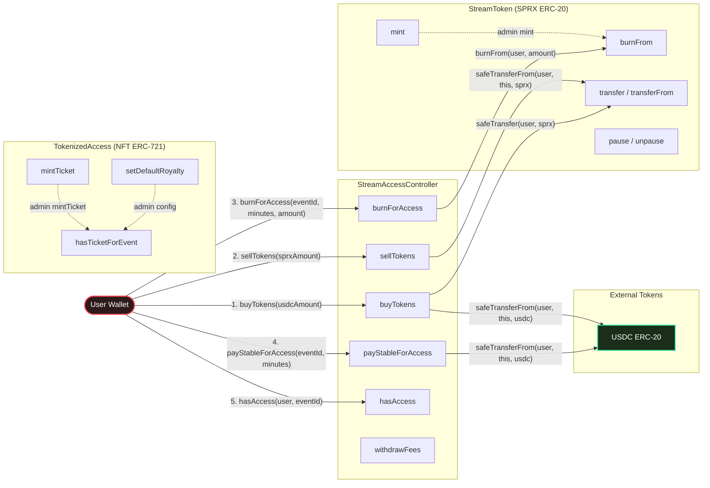

### 4.2 StreamToken (SPRX)

**Type:** ERC-20 Upgradeable Token  
**Symbol:** SPRX  
**Decimals:** 18  
**Initial Supply:** 1,000,000 SPRX minted to deployer

#### State Variables

| Variable | Type | Visibility | Description |
|---|---|---|---|
| (inherited) `_totalSupply` | uint256 | internal | Total token supply |
| (inherited) `_balances` | mapping(address => uint256) | internal | Token balances |
| (inherited) `_allowances` | mapping(address => mapping(address => uint256)) | internal | Allowance table |

#### Role-Based Access

| Role | Grants | Granter |
|---|---|---|
| `DEFAULT_ADMIN_ROLE` | Full admin | Deployer |
| `MINTER_ROLE` | Can mint tokens | DEFAULT_ADMIN |
| `PAUSER_ROLE` | Can pause/unpause transfers | DEFAULT_ADMIN |

#### Storage Layout (Upgradeable Gap)

```solidity
// 50 storage slots reserved for future variables
uint256[50] private __gap;
```

#### Core Functions

| Function | Mutability | Access | Description |
|---|---|---|---|
| `initialize(name, symbol, initialSupply, defaultAdmin)` | nonpayable | initializer | Contract initialization |
| `mint(to, amount)` | nonpayable | MINTER_ROLE | Create new tokens |
| `burnFrom(account, amount)` | nonpayable | Public (allowance) | Destroy tokens from account |
| `mintRewards(to, amount)` | nonpayable | DEFAULT_ADMIN | Mint reward tokens |
| `setMinter(account, allowed)` | nonpayable | DEFAULT_ADMIN | Toggle minter role |
| `pause()` | nonpayable | PAUSER_ROLE | Emergency pause |
| `unpause()` | nonpayable | PAUSER_ROLE | Resume transfers |

#### Key Logic: `_update()`

```solidity
function _update(address from, address to, uint256 value) internal override whenNotPaused {
    super._update(from, to, value);
}
```

All token transfers, mints, and burns are gated by the `whenNotPaused` modifier. When paused, no token movement is allowed.

---

### 4.3 TokenizedAccess (NFT Tickets)

**Type:** ERC-721 Upgradeable NFT  
**Symbol:** SPRXNFT  
**Features:** ERC-2981 Royalties, URI Storage, Pausable, AccessControl

#### Structs

```solidity
struct TicketData {
    uint256 eventId;      // Associated sports event
    uint8 accessLevel;    // 0=general, 1=VIP, 2=premium
    string seat;          // Seat identifier (e.g., "A1")
}
```

#### State Variables

| Variable | Type | Description |
|---|---|---|
| `_tokenIdCounter` | uint256 | Auto-incrementing token ID |
| `_tickets` | mapping(uint256 => TicketData) | Token ID → ticket metadata |
| `_eventBalances` | mapping(uint256 => mapping(address => uint256)) | Event ID → Owner → ticket count |

#### Event

```solidity
event TicketMinted(
    address indexed to,
    uint256 indexed tokenId,
    uint256 indexed eventId,
    uint8 accessLevel,
    string seat
);
```

#### Core Functions

| Function | Mutability | Access | Description |
|---|---|---|---|
| `initialize(name, symbol, royaltyReceiver, feeNumerator, defaultAdmin)` | nonpayable | initializer | Contract init |
| `mintTicket(to, eventId, accessLevel, seat, uri)` | nonpayable | MINTER_ROLE | Mint NFT ticket |
| `hasTicketForEvent(owner, eventId)` | view | Public | Check ticket ownership |
| `getTicketData(tokenId)` | view | Public | Get ticket metadata |
| `setDefaultRoyaltyConfig(receiver, feeNumerator)` | nonpayable | DEFAULT_ADMIN | Update royalty config |
| `pause()` / `unpause()` | nonpayable | PAUSER_ROLE | Emergency controls |

#### Transfer Logic: `_update()` Override

On ticket transfer, the contract correctly adjusts `_eventBalances`:
- Decrements balance from the **old owner** (`from`)
- Increments balance for the **new owner** (`to`)
- Uses `whenNotPaused` to block transfers during emergencies

---

### 4.4 StreamAccessController

**Type:** Access Control + Exchange Controller  
**Pattern:** Transparent Proxy  

#### Structs

```solidity
struct AccessRecord {
    uint256 eventId;
    uint256 expiresAt;  // Unix timestamp when access expires
    bool active;
}
```

#### State Variables

| Variable | Type | Description |
|---|---|---|
| `sprxToken` | IERC20 | The SPRX token contract |
| `stablecoin` | IERC20 | USDC stablecoin contract |
| `ticketContract` | address | TokenizedAccess contract address |
| `sprxPerStable` | uint256 | Exchange rate: SPRX per 1 USDC (6 decimals) |
| `stableCostPerMinute` | uint256 | Cost in USDC (6 decimals) per minute of access |
| `feeBps` | uint256 | Fee in basis points (1% = 100) |
| `accumulatedFees` | uint256 | Total USDC fees collected |
| `userAccess` | mapping(address => mapping(uint256 => AccessRecord)) | Per-user, per-event access records |
| `_locked` | uint256 | Custom reentrancy guard |

#### Events

```solidity
event AccessGranted(address indexed user, uint256 indexed eventId, uint256 expiresAt);
event TokensPurchased(address indexed buyer, uint256 stableAmount, uint256 sprxAmount);
event TokensSold(address indexed seller, uint256 sprxAmount, uint256 stableAmount, uint256 fee);
event FeesWithdrawn(address indexed to, uint256 amount);
event RatesUpdated(uint256 sprxPerStable, uint256 stableCostPerMinute, uint256 feeBps);
```

#### Core Functions

| Function | Mutability | Access | Description |
|---|---|---|---|
| `initialize(...)` | nonpayable | initializer | Init with token addresses + rates |
| `burnForAccess(eventId, minutes, burnAmount)` | nonpayable | nonReentrant | Burn SPRX for time-limited access |
| `payStableForAccess(eventId, minutes)` | nonpayable | nonReentrant | Pay USDC for time-limited access |
| `buyTokens(stableAmount)` | nonpayable | nonReentrant | Buy SPRX with USDC |
| `sellTokens(sprxAmount)` | nonpayable | nonReentrant | Sell SPRX for USDC (fee deducted) |
| `hasAccess(user, eventId)` | view | Public | Check if access is active and not expired |
| `withdrawFees(to)` | nonpayable | DEFAULT_ADMIN | Collect accumulated fees |
| `setRates(sprxPerStable, costPerMinute, feeBps)` | nonpayable | DEFAULT_ADMIN | Update economic parameters |

#### Access Calculation

**Burn for Access:**
```
requiredBurn = stableCostPerMinute × accessMinutes × sprxPerStable × 10^12
```

**Pay Stable for Access:**
```
cost = stableCostPerMinute × accessMinutes
fee = (cost × feeBps) / 10000
totalCost = cost + fee
```

**Sell SPRX for USDC:**
```
stableAmount = (sprxAmount × 10^6) / (sprxPerStable × 10^18)
fee = (stableAmount × feeBps) / 10000
netStable = stableAmount - fee
```

**Buy SPRX with USDC:**
```
sprxAmount = stableAmount × sprxPerStable × 10^12
```

#### Reentrancy Guard

```solidity
modifier nonReentrant() {
    require(_locked == 1, "StreamAccessController: reentrant call");
    _locked = 2;
    _;
    _locked = 1;
}
```

> **Note:** This implementation initializes `_locked = 1` (unlocked state) and checks for `== 1`. This is the inverse convention of OpenZeppelin's ReentrancyGuard (where 0=unlocked, 1=locked). It works correctly but may cause confusion during audits.

---

### 4.5 Deployment Sequence

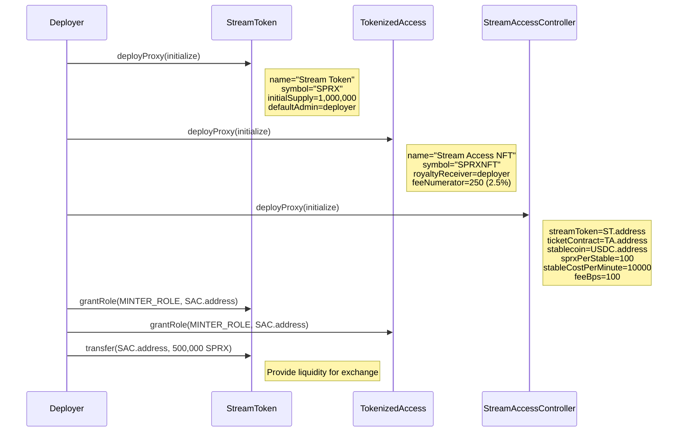

---

## 5. Layer 2: Backend API Server

### 5.1 Server Architecture

```mermaid
flowchart TB
    REQ([HTTP Request])
    
    subgraph "Express Middleware Stack"
        CORS[cors]
        HELMET[helmet]
        JSON[express.json]
        ROUTER[Router]
        ERR[errorHandler]
    end
    
    subgraph "Routes"
        EVENTS[events.js]
        EXCHANGE[exchange.js]
        TICKET[ticket.js]
        STREAM[stream.js]
    end
    
    subgraph "Dependencies"
        CONFIG[config/blockchain.js]
        HELPERS[utils/helpers.js]
        SESSIONS[In-Memory Map]
    end
    
    subgraph "Blockchain Layer"
        PROVIDER[JsonRpcProvider]
        ACCESS_CONTRACT[AccessContract<br/>ethers.Contract]
        TICKET_CONTRACT[TicketContract<br/>ethers.Contract]
        TOKEN_CONTRACT[TokenContract<br/>ethers.Contract]
    end

    REQ --> CORS --> HELMET --> JSON --> ROUTER
    
    ROUTER --> EVENTS
    ROUTER --> EXCHANGE
    ROUTER --> TICKET
    ROUTER --> STREAM
    
    EVENTS -.->|"static data"| JSON_DATA[JSON Events]
    EXCHANGE --> ACCESS_CONTRACT
    TICKET --> TICKET_CONTRACT
    STREAM --> ACCESS_CONTRACT
    STREAM --> SESSIONS
    
    CONFIG --> PROVIDER
    CONFIG --> ACCESS_CONTRACT
    CONFIG --> TICKET_CONTRACT
    CONFIG --> TOKEN_CONTRACT
    
    HELPERS --> TICKET
    HELPERS --> STREAM
    
    ROUTER -.-> ERR
    
    style EVENTS fill:#2a2a3e,stroke:#4b9bff
    style EXCHANGE fill:#2a2a3e,stroke:#4b9bff
    style TICKET fill:#2a2a3e,stroke:#4b9bff
    style STREAM fill:#2a2a3e,stroke:#4b9bff
```

### 5.2 Route Specifications

#### `GET /api/health`

**Purpose:** Service health check  
**Response:**
```json
{
  "status": "ok",
  "timestamp": 1764139234000
}
```

#### `GET /api/events`

**Purpose:** Return all sport events  
**Data Source:** Static array (6 hardcoded events)  
**Response:**
```json
[
  {
    "id": 1,
    "name": "Premier League: Arsenal vs Chelsea",
    "sport": "Football",
    "startTime": "2026-02-15T20:00:00Z",
    "thumbnail": "https://images.unsplash.com/...",
    "isLive": true,
    "costPerMinute": 0.01
  }
]
```

#### `GET /api/exchange/rate`

**Purpose:** Fetch on-chain exchange rates with fallback  
**Flow:**
1. If `accessContract` is configured → read `sprxPerStable()`, `stableCostPerMinute()`, `feeBps()` from on-chain
2. If not configured → return default values (100, 10000, 100)

**Response:**
```json
{
  "sprxPerStable": "100",
  "stableCostPerMinute": "10000",
  "feeBps": "100",
  "source": "on-chain"
}
```

#### `POST /api/ticket/verify`

**Purpose:** Verify if a wallet holds an NFT ticket for a specific event  
**Request:**
```json
{
  "wallet": "0x3C44CdDdB6a900fa2b585dd299e03d12FA4293BC",
  "eventId": 1
}
```

**Validation:**
1. Both `wallet` and `eventId` required → 400 if missing
2. `isValidAddress(wallet)` → 400 if invalid
3. `ticketContract` configured? → 200 with `{ verified: false, message: "Ticket contract not configured" }` if not
4. Call `ticketContract.hasTicketForEvent(wallet, eventId)` → return result

**Response:**
```json
{
  "verified": true,
  "wallet": "0x3C44CdDdB6a900fa2b585dd299e03d12FA4293BC",
  "eventId": 1
}
```

#### `POST /api/stream/start`

**Purpose:** Start a streaming session after access validation  
**Request:**
```json
{
  "wallet": "0x3C44CdDdB6a900fa2b585dd299e03d12FA4293BC",
  "eventId": 2
}
```

**Flow:**
1. Validation (wallet + eventId + address format)
2. If `accessContract` is configured → call `hasAccess(wallet, eventId)` → 403 if denied
3. Generate UUID session ID
4. Store session in `Map`: `{ sessionId, wallet, eventId, startTime, active: true }`

**Response:**
```json
{
  "sessionId": "e30644a4-88fe-4ec1-a820-e2de302f16b3",
  "eventId": 2,
  "wallet": "0x3C44CdDdB6a900fa2b585dd299e03d12FA4293BC",
  "status": "active"
}
```

#### `POST /api/stream/end`

**Purpose:** End a streaming session and report duration  
**Request:**
```json
{
  "sessionId": "e30644a4-88fe-4ec1-a820-e2de302f16b3"
}
```

**Validation:**
1. `sessionId` required → 400 if missing
2. Session exists in Map → 404 if not found
3. Session already ended → 400 if done

**Response:**
```json
{
  "sessionId": "e30644a4-88fe-4ec1-a820-e2de302f16b3",
  "status": "ended",
  "duration": 367
}
```

### 5.3 Blockchain Configuration

```javascript
const provider = new ethers.JsonRpcProvider(process.env.RPC_URL);
// ABIs defined inline for read-only functions
// Contracts created only if addresses are configured
const ticketContract = ticketAddress
  ? new ethers.Contract(ticketAddress, TICKET_ABI, provider)
  : null;
```

**ABIs Used:**

| Contract | Functions |
|---|---|
| Ticket | `hasTicketForEvent()`, `getTicketData()` |
| Access | `hasAccess()`, `sprxPerStable()`, `stableCostPerMinute()`, `feeBps()`, `accumulatedFees()` |
| Token | `balanceOf()`, `name()`, `symbol()`, `decimals()` |

### 5.4 Error Handling

```javascript
function errorHandler(err, req, res, next) {
  const statusCode = err.statusCode || 500;
  const message = err.message || "Internal server error";
  res.status(statusCode).json({ error: message, ...(stack if development) });
}
```

### 5.5 WebSocket Placeholder

The `src/websocket/socket.js` file contains a placeholder for future Socket.io integration. It currently only logs a message. Planned capabilities:
- Real-time session heartbeat
- Live event updates
- Viewer count broadcasting

---

## 6. Layer 3: Frontend DApp

### 6.1 Component Architecture

```mermaid
flowchart TB
    MAIN[main.tsx]
    APP[App.tsx]
    
    subgraph "Providers"
        WAGMI[WagmiProvider]
        QUERY[QueryClientProvider]
        RBK[RainbowKitProvider]
    end
    
    subgraph "Components"
        HEADER[Header]
        HERO[LandingHero]
        TABS[Tab Navigation]
        EVENTS[EventsTab]
        EXCHANGE[ExchangeTab]
        STADIUM[StadiumRoom]
        FOOTER[Footer]
        STATUS[StatusBar]
    end
    
    subgraph "3D Stadium Sub-Components"
        MAIN_SCREEN[MainScreen<br/>YouTube Embed]
        SIDE_SCREENS[SideScreens]
        SCOREBOARD[ScoreBoard]
        SEATS[StadiumSeats<br/>Animated Audience]
        FLOOR[Floor + Grid]
        LIGHTING[Lighting]
        PARTICLES[Particles]
        CAMERA[MotionSensorCamera]
    end
    
    subgraph "Hooks"
        USE_EVENTS[useEvents]
        USE_BALANCE[useBalance]
        USE_EXCHANGE[useExchange]
        USE_ACCESS[useAccess]
    end

    MAIN --> WAGMI --> QUERY --> RBK --> APP
    
    APP --> HEADER
    APP --> HERO
    APP --> TABS
    APP --> EVENTS
    APP --> EXCHANGE
    APP --> STADIUM
    APP --> FOOTER
    APP --> STATUS
    
    APP --> USE_EVENTS
    APP --> USE_BALANCE
    APP --> EXCHANGE --> USE_EXCHANGE
    APP --> USE_ACCESS
    
    STADIUM --> MAIN_SCREEN
    STADIUM --> SIDE_SCREENS
    STADIUM --> SCOREBOARD
    STADIUM --> SEATS
    STADIUM --> FLOOR
    STADIUM --> LIGHTING
    STADIUM --> PARTICLES
    STADIUM --> CAMERA
    
    style APP fill:#1a1a2e,stroke:#8247e5
    style MAIN fill:#1a1a2e,stroke:#4b9bff
    style STADIUM fill:#2e1a2e,stroke:#c084fc
```

### 6.2 State Management

**App-level State (via React hooks, no global store):**

| State | Type | Description |
|---|---|---|
| `activeTab` | `"events" \| "exchange" \| "stadium"` | Current active tab |
| `status` | `StatusMessage \| null` | Toast notification state |
| Wallet state | Through wagmi `useAccount` | isConnected, address, chainId |
| Balances | Through wagmi `useReadContract` | SPRX, USDC, native POL |

### 6.3 Data Flow: Events Tab to Backend

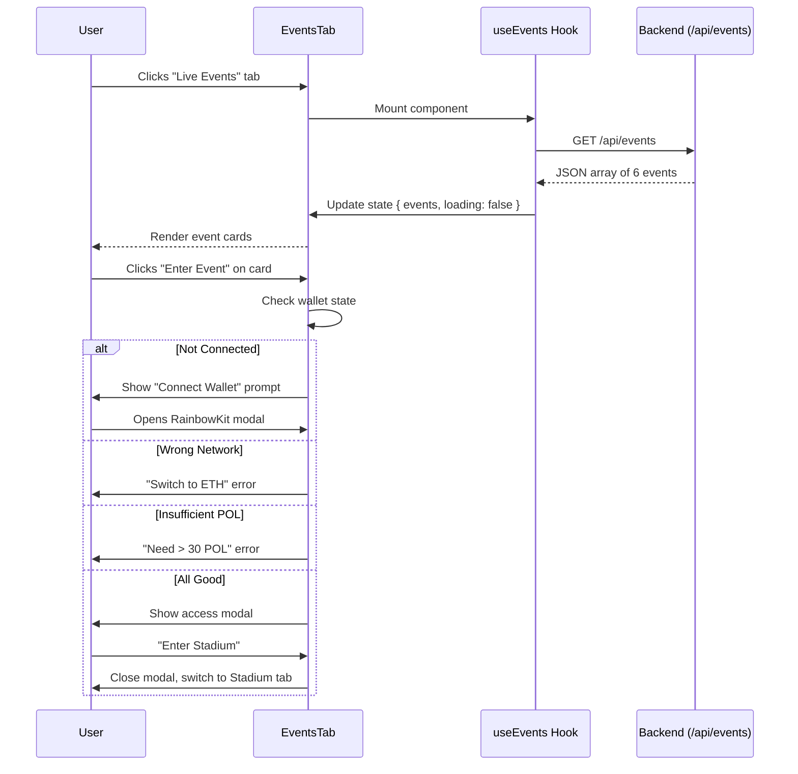

### 6.4 Data Flow: Exchange Tab to Contracts

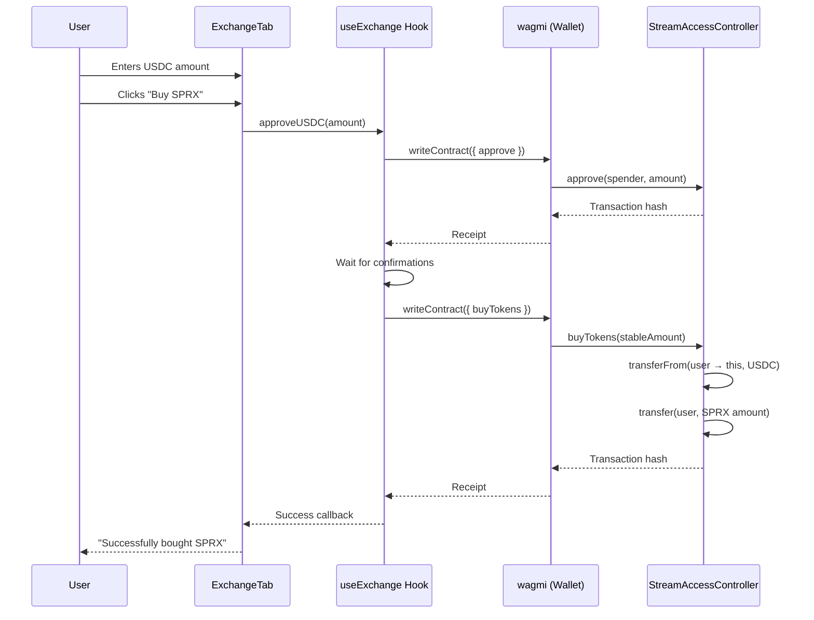

### 6.5 3D Stadium Architecture

```mermaid
flowchart TB
    STADIUM[StadiumRoom.tsx]
    
    subgraph "Component State"
        FEED[feedIndex: number]
        VR[isVrMode: boolean]
        VR_FALLBACK[isVrFallbackMode: boolean]
        SOUND[isSoundOn: boolean]
        CHEER[isCrowdPulseOn: boolean]
        AUDIO_STATUS[audioStatus: string]
    end
    
    subgraph "Three.js Scene (Canvas)"
        CAM[MotionSensorCamera]
        ORBIT[OrbitControls]
        LIGHTING[Lighting]
        FLOOR[Floor]
        SEATS[StadiumSeats]
        MAIN_SCREEN[MainScreen]
        SIDE_SCREENS[SideScreens]
        SCOREBOARD[ScoreBoard]
        PARTICLES[Particles]
        ENV[Environment night preset]
    end
    
    subgraph "Audio System"
        AMBIENCE[new Audio(crowd-ambience.mp3)]
        CHEER_AUDIO[new Audio(crowd-cheer.mp3)]
    end
    
    subgraph "YouTube Feeds"
        YT1[M7lc1UVf-V

---

## Table of Contents

1. [System Overview](#1-system-overview)
2. [Architecture Diagram](#2-architecture-diagram)
3. [Layer Breakdown](#3-layer-breakdown)
4. [Smart Contract Layer](#4-smart-contract-layer)
5. [Backend Layer](#5-backend-layer)
6. [Frontend Layer](#6-frontend-layer)
7. [Data Flow & End-to-End Schemas](#7-data-flow--end-to-end-schemas)
8. [API Reference](#8-api-reference)
9. [Deployment Architecture](#9-deployment-architecture)
10. [Security Considerations](#10-security-considerations)
11. [Known Issues & Technical Debt](#11-known-issues--technical-debt)
12. [Future Architecture Roadmap](#12-future-architecture-roadmap)

---

## 1. System Overview

Tokenized SPRX is a multi-layer Web3 sports platform combining:

- **Smart Contracts** — Upgradeable token, NFT, and access control logic on Polygon Amoy
- **Backend API** — Express.js server with on-chain reads, session management, and Swagger docs
- **Frontend DApp** — React + Vite app with wallet integration, 3D stadium, and token exchange UI

### Core Features

| Feature | Description |
|---|---|
| **SPRX Token** | ERC-20 utility token for platform access and exchange |
| **NFT Tickets** | ERC-721 event tickets with seat assignment and royalty support |
| **Access Control** | Burn-to-access (SPRX) or pay-to-access (USDC) for live events |
| **Token Exchange** | Buy/sell SPRX tokens with USDC stablecoin |
| **Live Events** | Curated sports event catalog with metadata |
| **3D Stadium** | Real-time 3D virtual stadium with YouTube feeds, crowd audio, and VR mode |

### Technology Stack

| Area | Technology |
|---|---|
| **Smart Contracts** | Solidity 0.8.28, Hardhat 2.27, OpenZeppelin Upgradeable |
| **Blockchain** | Polygon Amoy (testnet) |
| **Backend** | Node.js, Express 4, ethers.js, Swagger UI |
| **Frontend** | React 18, Vite 7, RainbowKit, wagmi, viem, Three.js (react-three-fiber) |
| **Styling** | CSS (glassmorphism design system) |
| **Wallet** | MetaMask / RainbowKit, WalletConnect |

---

## 2. Architecture Diagram

### 2.1 High-Level System Architecture

```mermaid
flowchart TB
    subgraph User["User Layer"]
        W[Web Browser<br/>Mobile / Desktop]
    end

    subgraph Frontend["Frontend DApp"]
        UI[React App<br/>Vite Build]
        WALLET[RainbowKit + wagmi<br/>Wallet Connection]
        THREE[3D Stadium<br/>react-three-fiber]
    end

    subgraph Backend["Backend API Server"]
        API[Express.js<br/>REST API]
        SWAGGER[Swagger Docs<br/>/api/docs]
        SESSIONS[In-Memory<br/>Session Store]
        WEBSOCKET[Socket.io<br/>Placeholder]
    end

    subgraph Blockchain["Blockchain Layer"]
        PROVIDER[ethers.js<br/>JSON-RPC Provider]
        CONTRACTS[Polygon Amoy<br/>Smart Contracts]
    end

    subgraph External["External Services"]
        IPFS[IPFS<br/>Metadata Storage]
        YOUTUBE[YouTube<br/>Video Feeds]
        WALLETCONNECT[WalletConnect<br/>Bridge]
    end

    W -->|Browser| UI
    W -->|MetaMask| WALLET
    WALLET -->|EIP-1193| WALLETCONNECT
    
    UI -->|HTTP /api/*| API
    UI -->|read-only| PROVIDER
    UI -->|write txs| WALLET

    API -->|on-chain reads| PROVIDER
    PROVIDER -->|JSON-RPC| CONTRACTS

    THREE -->|YouTube Embeds| YOUTUBE
    API -->|SWAGGER| SWAGGER
    API -->|Session Data| SESSIONS
    API -.->|Future| WEBSOCKET
```

### 2.2 Contract Architecture (Upgradeable Proxy)

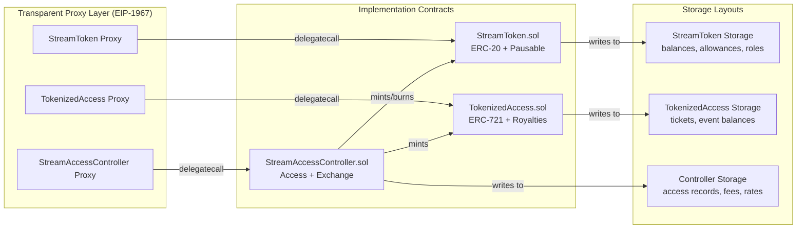

### 2.3 Backend Route Architecture

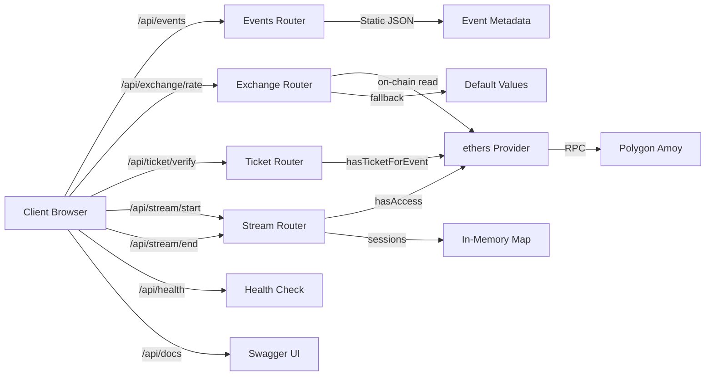

---

## 3. Layer Breakdown

### 3.1 Responsibility Matrix

| Layer | Responsibility | Dependencies |
|---|---|---|
| **Smart Contracts** | Token accounting, NFT minting/ownership, access gating, token exchange, fees | OpenZeppelin, Hardhat |
| **Backend** | Event metadata API, on-chain data verification, stream session lifecycle, API docs | ethers.js, Express, Swagger |
| **Frontend** | UI rendering, wallet connection, transaction signing, 3D visualization, audio playback | RainbowKit, wagmi, Three.js |

### 3.2 Communication Patterns

| Flow | Pattern | Protocol |
|---|---|---|
| Frontend ↔ Backend | REST API | HTTP/1.1 (JSON) |
| Backend → Blockchain | On-chain reads (view functions) | JSON-RPC over HTTPS |
| Frontend → Blockchain | Transaction signing via wallet | EIP-1193 (wallet RPC) |
| Frontend → YouTube | Embedded iframe | HTTPS |
| Backend ↔ Frontend (future) | Real-time updates | WebSocket (Socket.io) |

---

## 4. Smart Contract Layer

### 4.1 StreamToken.sol — ERC-20 Utility Token

#### Purpose
The native SPRX utility token used for platform access, exchange, and rewards.

#### Contract Spec

| Property | Value |
|---|---|
| **Standard** | ERC-20 (OpenZeppelin Upgradeable) |
| **Extras** | AccessControl, Pausable |
| **Decimals** | 18 |
| **Initial Supply** | 1,000,000 SPRX |
| **Proxy Type** | Transparent (EIP-1967) |

#### State Variables

```solidity
// Inherited from OpenZeppelin
mapping(address => uint256) private _balances;
mapping(address => mapping(address => uint256)) private _allowances;
uint256 private _totalSupply;

// AccessControl
mapping(bytes32 => RoleData) private _roles;

// Pausable
bool private _paused;

// Custom roles
bytes32 public constant PAUSER_ROLE = keccak256("PAUSER_ROLE");
bytes32 public constant MINTER_ROLE = keccak256("MINTER_ROLE");
```

#### Key Functions

| Function | Access | Description |
|---|---|---|
| `initialize(name, symbol, initialSupply, defaultAdmin)` | Initializer | Sets up token, mints initial supply, grants roles |
| `mint(to, amount)` | MINTER_ROLE | Creates new tokens |
| `burnFrom(account, amount)` | Public (allowance) | Burns tokens from address with allowance |
| `mintRewards(to, amount)` | DEFAULT_ADMIN | Mints reward tokens |
| `setMinter(account, allowed)` | DEFAULT_ADMIN | Grants/revokes minter role |
| `pause()` | PAUSER_ROLE | Emergency pause all transfers |
| `unpause()` | PAUSER_ROLE | Resume transfers |
| `_update(from, to, value)` | Internal override | Hook: enforces `whenNotPaused` on all transfers |

#### Storage Layout (Gap-Protected)

```
┌─────────────────────────────────┐
│ ERC20Upgradeable Storage        │  ~12 slots
├─────────────────────────────────┤
│ AccessControlUpgradeable Storage│  ~3 slots
├─────────────────────────────────┤
│ PausableUpgradeable Storage     │  1 slot
├─────────────────────────────────┤
│ __gap[50]                       │  50 slots
└─────────────────────────────────┘
```

### 4.2 TokenizedAccess.sol — ERC-721 NFT Ticket

#### Purpose
Represents event tickets as NFTs with on-chain metadata and royalty support.

#### Contract Spec

| Property | Value |
|---|---|
| **Standard** | ERC-721 + URI Storage + ERC-2981 (Royalties) |
| **Extras** | AccessControl, Pausable |
| **Proxy Type** | Transparent (EIP-1967) |

#### State Variables

```solidity
struct TicketData {
    uint256 eventId;
    uint8 accessLevel;
    string seat;
}

uint256 private _tokenIdCounter;                              // Auto-incrementing token ID
mapping(uint256 => TicketData) private _tickets;               // tokenId => TicketData
mapping(uint256 => mapping(address => uint256)) private _eventBalances; // eventId => owner => count

bytes32 public constant PAUSER_ROLE = keccak256("PAUSER_ROLE");
bytes32 public constant MINTER_ROLE = keccak256("MINTER_ROLE");
```

#### Key Functions

| Function | Access | Description |
|---|---|---|
| `initialize(name, symbol, receiver, fee, admin)` | Initializer | Setup with royalty config |
| `mintTicket(to, eventId, level, seat, uri)` | MINTER_ROLE | Mint new NFT ticket |
| `hasTicketForEvent(owner, eventId)` | External view | Check if owner has any ticket for event |
| `getTicketData(tokenId)` | External view | Get full ticket metadata |
| `setDefaultRoyaltyConfig(receiver, fee)` | DEFAULT_ADMIN | Update royalty configuration |
| `_update(to, tokenId, auth)` | Internal override | Updates `_eventBalances` on transfer |

#### Ticket Lifecycle

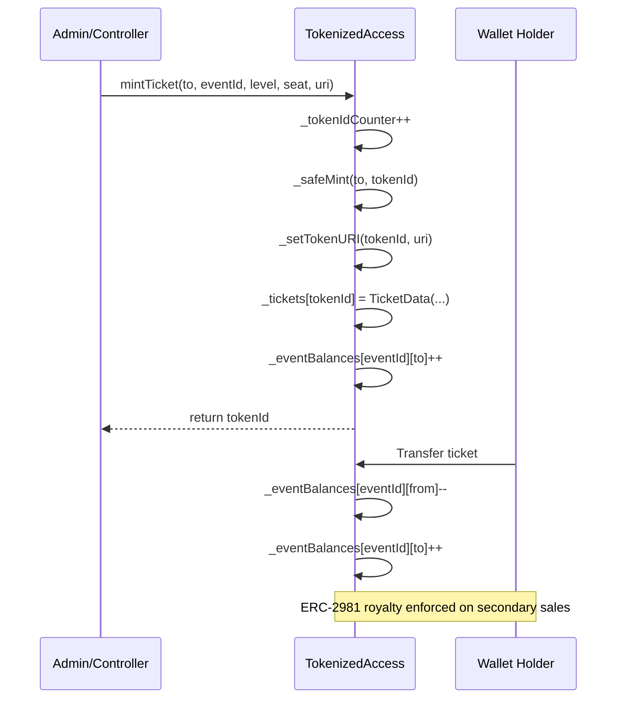

### 4.3 StreamAccessController.sol — Access & Exchange Controller

#### Purpose
Central business logic contract that gates event access and manages token exchange.

#### Contract Spec

| Property | Value |
|---|---|
| **Extras** | AccessControl, Pausable, Custom Reentrancy Guard |
| **Proxy Type** | Transparent (EIP-1967) |

#### State Variables

```solidity
// Token references
IERC20 public sprxToken;      // StreamToken (18 decimals)
IERC20 public stablecoin;     // USDC (6 decimals)
address public ticketContract; // TokenizedAccess

// Exchange rates
uint256 public sprxPerStable;           // e.g., 100 SPRX per 1 USDC
uint256 public stableCostPerMinute;     // e.g., 10000 (0.01 USDC, 6 decimals)
uint256 public feeBps;                  // e.g., 100 (1%)
uint256 public accumulatedFees;         // USDC fees collected

// Access records
struct AccessRecord {
    uint256 eventId;
    uint256 expiresAt;
    bool active;
}
mapping(address => mapping(uint256 => AccessRecord)) public userAccess;

// Reentrancy guard
uint256 private _locked;
```

#### Access Flow (Burn Method)

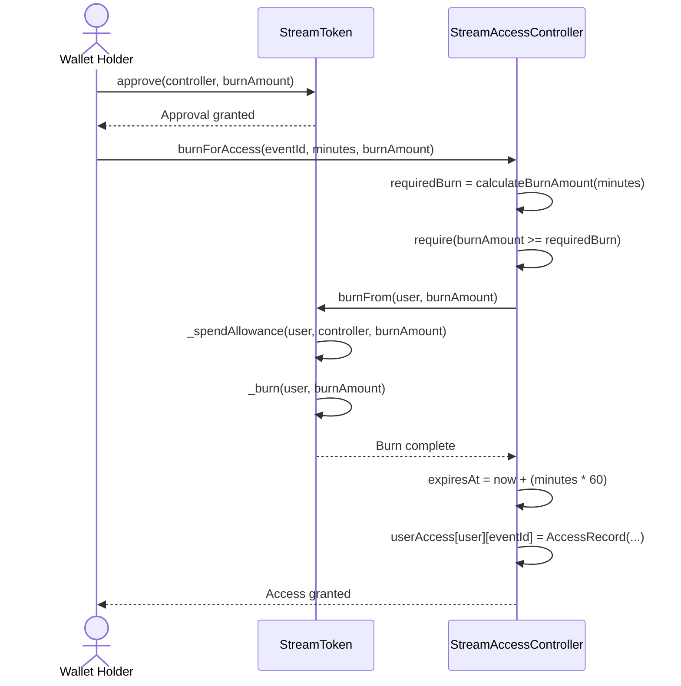

#### Access Flow (Pay Method)

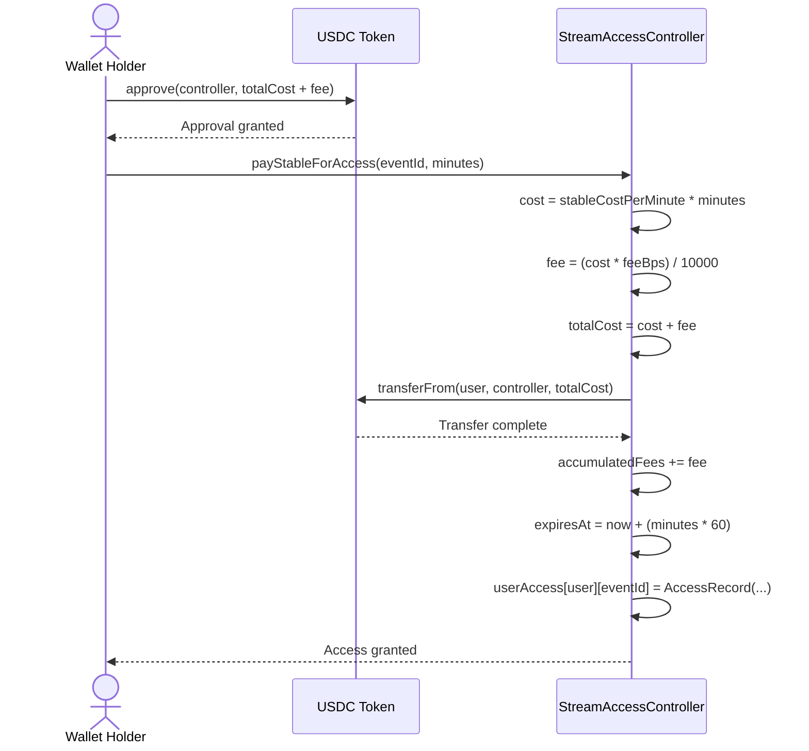

#### Exchange Flow (Buy SPRX)

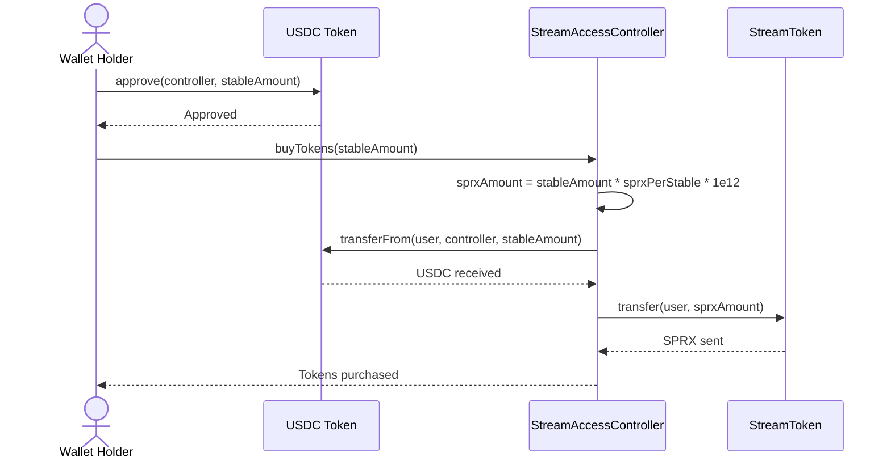

#### Exchange Flow (Sell SPRX)

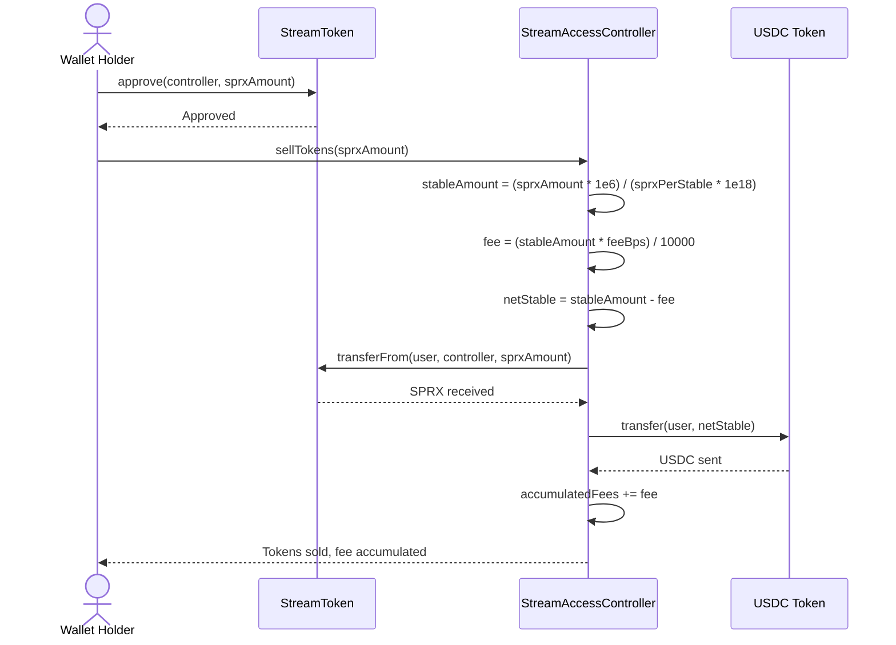

#### Key Rate Calculations

| Calculation | Formula | Example |
|---|---|---|
| **Burn amount for access** | `stableCostPerMin * minutes * sprxPerStable * 1e12` | 60 min × 10000 × 100 × 1e12 = 60 SPRX |
| **SPRX received for USDC** | `stableAmount * sprxPerStable * 1e12` | 1e6 USDC × 100 × 1e12 = 100 SPRX |
| **USDC received for SPRX** | `(sprxAmount * 1e6) / (sprxPerStable * 1e18)` | 1e20 SPRX / (100 * 1e18) = 1e6 USDC |
| **Fee on sell** | `(stableAmount * feeBps) / 10000` | 1e6 × 100 / 10000 = 10000 USDC (1%) |

---

## 5. Backend Layer

### 5.1 Server Architecture

```
Server/
├── src/
│   ├── server.js                  # Entry point: Express app setup
│   ├── config/
│   │   └── blockchain.js          # ethers provider + contract instances
│   ├── routes/
│   │   ├── events.js              # GET /api/events, GET /api/events/:id
│   │   ├── exchange.js            # GET /api/exchange/rate
│   │   ├── ticket.js              # POST /api/ticket/verify
│   │   └── stream.js              # POST /api/stream/start, POST /api/stream/end
│   ├── middleware/
│   │   └── errorHandler.js        # Centralized error handling
│   ├── docs/
│   │   └── openapi.js             # Swagger/OpenAPI 3.0.3 specification
│   ├── utils/
│   │   └── helpers.js             # isValidAddress, formatUnits, parseUnits
│   └── websocket/
│       └── socket.js              # Socket.io placeholder
└── .env.example
```

### 5.2 Over-the-Wire Data Schemas

#### Event Object
```json
{
  "id": 1,
  "name": "Premier League: Arsenal vs Chelsea",
  "sport": "Football",
  "startTime": "2026-02-15T20:00:00Z",
  "thumbnail": "https://images.unsplash.com/photo-1522778119026-...",
  "isLive": true,
  "costPerMinute": 0.01
}
```

#### Exchange Rate Response
```json
{
  "sprxPerStable": "100",
  "stableCostPerMinute": "10000",
  "feeBps": "100",
  "source": "on-chain"
}
```

#### Ticket Verification
```json
// Request
{ "wallet": "0x3C44...D12FA4293BC", "eventId": 1 }

// Response (verified)
{ "verified": true, "wallet": "0x3C44...", "eventId": 1 }

// Response (not configured)
{ "verified": false, "message": "Ticket contract not configured" }
```

#### Stream Session
```json
// Request (start)
{ "wallet": "0x3C44...", "eventId": 2 }

// Response (started)
{
  "sessionId": "e30644a4-88fe-4ec1-a820-e2de302f16b3",
  "eventId": 2,
  "wallet": "0x3C44...",
  "status": "active"
}

// Request (end)
{ "sessionId": "e30644a4-..." }

// Response (ended)
{
  "sessionId": "e30644a4-...",
  "status": "ended",
  "duration": 367
}
```

### 5.3 Event Data (Static Catalog)

| ID | Event | Sport | Live | Cost/min |
|---|---|---|---|---|
| 1 | Premier League: Arsenal vs Chelsea | Football | Yes | 0.01 |
| 2 | NBA Finals: Lakers vs Celtics | Basketball | Yes | 0.01 |
| 3 | Super Bowl LX | American Football | No | 0.02 |
| 4 | Wimbledon Finals: Men's Singles | Tennis | No | 0.01 |
| 5 | UFC 310: Championship Bout | MMA | Yes | 0.015 |
| 6 | ICC World Cup Final | Cricket | No | 0.01 |

### 5.4 Environment Configuration

```env
# Server/.env
PORT=8000
RPC_URL=https://rpc-amoy.polygon.technology
TICKET_ADDRESS=0x...           # TokenizedAccess proxy
ACCESS_ADDRESS=0x...           # StreamAccessController proxy
TOKEN_ADDRESS=0x...            # StreamToken proxy
```

### 5.5 Backend Route Processing Flow

```mermaid
flowchart TB
    REQ[Incoming Request] --> CORS[CORS Middleware]
    CORS --> HELMET[Helmet Middleware]
    HELMET --> JSON[express.json()]
    JSON --> ROUTER{Route Match}

    ROUTER -->|/api/events| EVENTS[Events Router]
    ROUTER -->|/api/exchange| EXCHANGE[Exchange Router]
    ROUTER -->|/api/ticket| TICKET[Ticket Router]
    ROUTER -->|/api/stream| STREAM[Stream Router]
    ROUTER -->|/api/docs| SWAGGER[Swagger UI]
    ROUTER -->|/api/health| HEALTH[JSON: {status:"ok"}]

    EVENTS --> STATIC[Return static event data]
    EXCHANGE --> ONCHAIN{Contract configured?}
    ONCHAIN -->|Yes| READ[Read rates from chain]
    ONCHAIN -->|No| DEFAULT[Return default values]
    READ --> RESP[Return JSON response]
    DEFAULT --> RESP

    TICKET --> VALIDATE{Valid wallet?}
    VALIDATE -->|No| 400[400 Bad Request]
    VALIDATE -->|Yes| VERIFY{Contract configured?}
    VERIFY -->|No| FALSE[{verified: false}]
    VERIFY -->|Yes| CHECK[hasTicketForEvent call]
    CHECK --> RSP[{verified: true/false}]

    STREAM --> S_VALIDATE{Valid wallet?}
    S_VALIDATE -->|No| 400_BAD[400 Bad Request]
    S_VALIDATE -->|Yes| S_ACCESS{hasAccess?}
    S_ACCESS -->|No| 403[403 Forbidden]
    S_ACCESS -->|Yes| SESSION[Create session UUID]
    SESSION --> S_RESP[Return session details]

    RESP & 400 & FALSE & RSP & 400_BAD & 403 & S_RESP --> ERROR{Error?}
    ERROR -->|Yes| ERROR_HANDLER[errorHandler Middleware]
    ERROR -->|No| FINAL[Send Response]
    ERROR_HANDLER --> FINAL
```

---

## 6. Frontend Layer

### 6.1 Component Architecture

```mermaid
flowchart TB
    APP[App.tsx<br/>State: activeTab, status]
    
    subgraph Layout["Layout Components"]
        HEADER[Header.tsx<br/>ConnectButton, Balances, Network]
        HERO[LandingHero.tsx<br/>Brand hero with stock images]
        FOOTER[Footer.tsx<br/>Copyright, Design Credit]
    end

    subgraph Tabs["Tab Content"]
        EVENTS[EventsTab.tsx<br/>Event Cards, Access Modal]
        EXCHANGE[ExchangeTab.tsx<br/>Buy/Sell SPRX Forms]
        STADIUM[StadiumRoom.tsx<br/>3D Virtual Stadium]
    end

    subgraph Stadium["3D Stadium Components"]
        FLOOR[Floor.tsx<br/>Stage + Grid]
        LIGHTING[Lighting.tsx<br/>Animated Spotlights]
        SEATS[StadiumSeats.tsx<br/>8x20 Seats + Audience]
        SCREEN[MainScreen.tsx<br/>YouTube Embed Screen]
        SIDE[SideScreens.tsx<br/>Auxiliary Screens]
        SCORE[ScoreBoard.tsx<br/>Animated Score Display]
        PARTICLES[Particles.tsx<br/>200 Floating Sparkles]
    end

    subgraph Hooks["Custom Hooks"]
        H_EVENTS[useEvents<br/>Fetch /api/events]
        H_BALANCE[useBalance<br/>SPRX + USDC balances]
        H_EXCHANGE[useExchange<br/>Token buy/sell]
        H_ACCESS[useAccess<br/>Burn/pay for access]
    end

    subgraph Shared["Shared"]
        WALLET[wallet.ts<br/>wagmi config, addresses]
        TYPES[types/index.ts<br/>TypeScript interfaces]
        STATUSBAR[StatusBar.tsx<br/>Toast notifications]
    end

    APP --> HEADER
    APP --> HERO
    APP --> Tabs
    APP --> FOOTER
    APP --> STATUSBAR

    EVENTS --> H_EVENTS
    EXCHANGE --> H_EXCHANGE
    STADIUM --> Stadium
    HEADER --> H_BALANCE

    SEATS --> FLOOR
    SCREEN --> SCORE
    SCREEN --> SIDE
    STADIUM --> LIGHTING
    STADIUM --> PARTICLES
```

### 6.2 Application State Management

```
App State:
├── activeTab: "events" | "exchange" | "stadium"
├── status: { type: "success"|"error"|"pending", message: string } | null
│
├── Derived from wagmi (via RainbowKit):
│   ├── isConnected: boolean
│   ├── address: `0x${string}` | undefined
│   ├── chainId: number
│   └── nativeBalance: { formatted: string, symbol: string }
│
├── Computed (in App.tsx):
│   ├── isAmoy: chainId === 80002
│   ├── polBalance: parseFloat(nativeBalance?.formatted ?? "0")
│   └── hasPolAccess: isConnected && isAmoy && polBalance > 30
│
└── Passed down via props to child components
```

### 6.3 Wallet Configuration

```typescript
// wallet.ts
export const wagmiConfig = getDefaultConfig({
  appName: "Tokenized SPRX",
  projectId: import.meta.env.VITE_APP_WALLETCONNECT_PROJECT_ID,
  chains: [polygonAmoy],                    // Only Amoy configured
  ssr: false,
});

export const CHAIN_ID = 80002;              // Polygon Amoy chain ID

export const CONTRACT_ADDRESSES = {
  streamToken:       env VITE_APP_TOKEN_ADDRESS,
  ticketContract:    env VITE_APP_TICKET_ADDRESS,
  accessController:  env VITE_APP_ACCESS_ADDRESS,
  usdc:              env VITE_APP_USDC_ADDRESS,
};

export const BACKEND_URL = env VITE_APP_BACKEND_URL;
```

### 6.4 User Flow: Full Experience

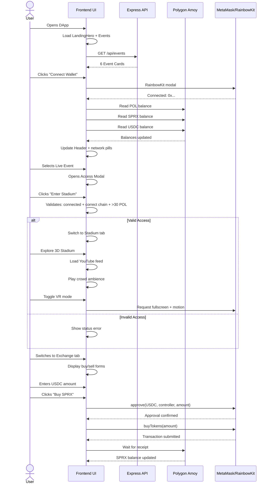

### 6.5 3D Stadium Architecture

```mermaid
flowchart TB
    subgraph Canvas["<Canvas> @react-three/fiber"]
        CAM[PerspectiveCamera<br/>pos: [0, 8, 25]]
        ORBIT[OrbitControls<br/>enabled in non-VR mode]
        MOTION[MotionSensorCamera<br/>enabled in VR mode]

        LIGHT[Lighting<br/>Animated spot + ambient]
        FLOOR[Floor<br/>Glowing grid + stage]
        SEATS[StadiumSeats<br/>160 seats with animated audience]
        SCREEN[MainScreen<br/>YouTube iframe via Html]
        SIDE_S[SideScreens<br/>Left/Right screens]
        SCORE_B[ScoreBoard<br/>Animated floating score]
        PARTICLES[Particles<br/>200 floating sparkles]
        ENV[Environment<br/>Night preset]
    end

    subgraph Audio["Local Audio System"]
        AMBIENCE[crowd-ambience.mp3<br/>Loop, vol 0.55]
        CHEER[crowd-cheer.mp3<br/>Loop, vol 0.45]
    end

    subgraph Controls["Stadium Controls"]
        SOUND[Enable/Disable Crowd]
        CHEER_BTN[Enable/Disable Cheers]
        FEED[Next Feed<br/>Rotate YouTube videos]
        VR[Enter/Exit VR Mode]
    end

    SCREEN --> YT[YouTube Embedded Feed<br/>3 rotating IDs]
    MOTION --> ORIENT[DeviceOrientationEvent<br/>Beta/Gamma mapping]
    VR --> FULL[Fullscreen API<br/>+ Screen Orientation Lock]
    VR --> FALLBACK[Immersive Fallback Mode<br/>for non-fullscreen browsers]
```

---

## 7. Data Flow & End-to-End Schemas

### 7.1 Access Gating Flow (Burn SPRX)

```
┌──────────┐     ┌──────────────┐     ┌───────────────┐     ┌─────────────┐
│  User    │     │  Frontend    │     │  Backend      │     │  Blockchain │
│  Wallet  │     │  (React)     │     │  (Express)    │     │  (Amoy)     │
└────┬─────┘     └──────┬───────┘     └───────┬───────┘     └──────┬──────┘
     │                  │                     │                    │
     │  1. Connect      │                     │                    │
     │◄────────────────►│                     │                    │
     │  (RainbowKit)    │                     │                    │
     │                  │                     │                    │
     │  2. Approve      │                     │                    │
     │◄────────────────►│──────────────────────────────────────────►│
     │  SPRX ->         │                    │                    │
     │  Controller      │                     │                    │
     │                  │                     │                    │
     │  3. burnForAccess│                     │                    │
     │  (tx)            │──────────────────────────────────────────►│
     │                  │                     │                    │
     │                  │                     │  4. POST /stream/start │
     │                  │────────────────────►│                    │
     │                  │                     │                    │
     │                  │                     │  5. hasAccess()    │
     │                  │                     │───────────────────►│
     │                  │                     │◄───────────────────│
     │                  │                     │     true/false     │
     │                  │                     │                    │
     │                  │  6. Session Created │                    │
     │                  │◄────────────────────│                    │
     │                  │   { sessionId }     │                    │
     │                  │                     │                    │
     │  7. View Stadium │                     │                    │
     │◄────────────────►│                     │                    │
```

### 7.2 Token Exchange Flow (Buy SPRX)

```
┌──────────┐     ┌──────────────┐     ┌─────────────┐
│  User    │     │  Frontend    │     │  Blockchain  │
│  Wallet  │     │  (React)     │     │  (Amoy)      │
└────┬─────┘     └──────┬───────┘     └──────┬──────┘
     │                  │                    │
     │  1. Enter USDC   │                    │
     │     amount       │                    │
     │─────────────────►│                    │
     │                  │                    │
     │  2. approve(     │                    │
     │     USDC,        │───────────────────►│
     │     controller,  │                    │
     │     amount)      │◄───────────────────│
     │                  │  Approval receipt  │
     │  3. buyTokens(   │                    │
     │     amount)      │───────────────────►│
     │                  │                    │
     │                  │  ┌─────────────────┘
     │                  │  │
     │                  │  │  Contract Logic:
     │                  │  │  1. transferFrom(user) USDC
     │                  │  │  2. Calculate sprxAmount
     │                  │  │  3. transfer(user) SPRX
     │